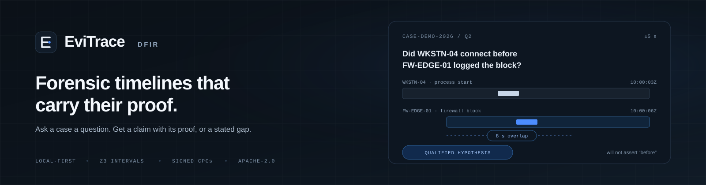
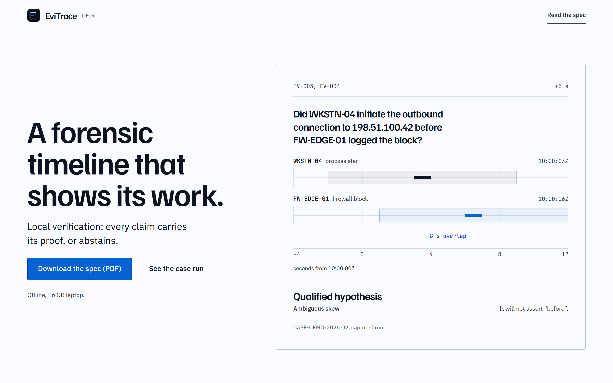
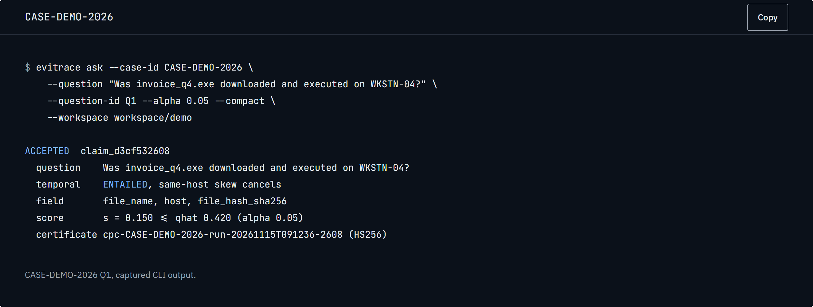
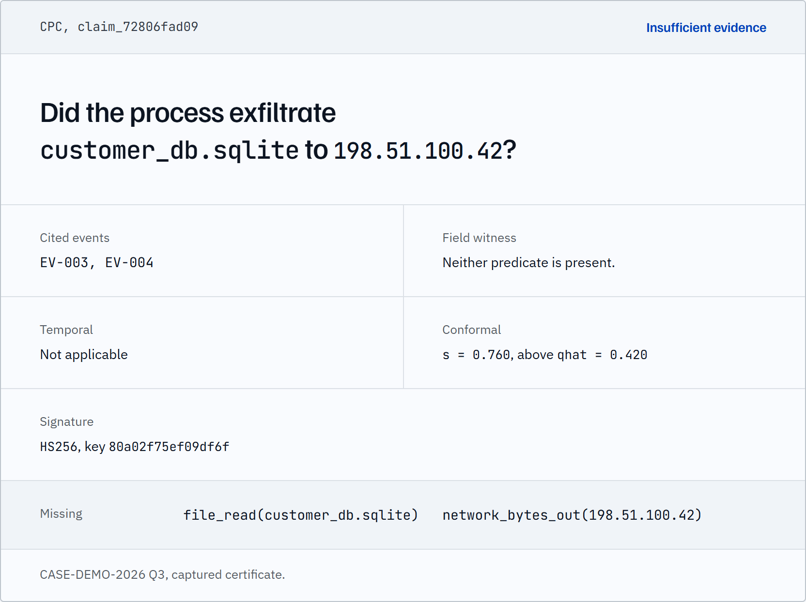
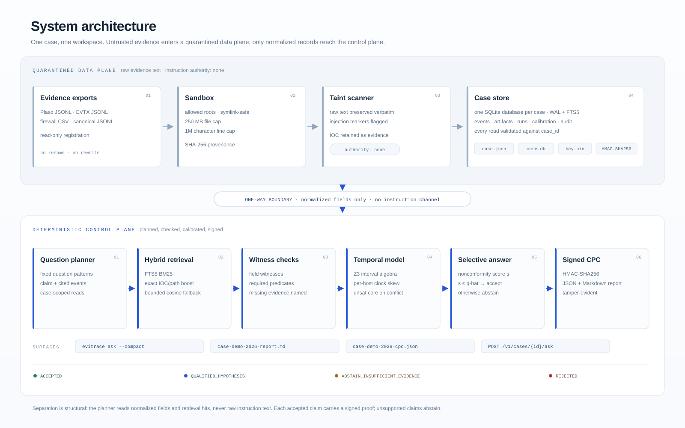

<p align="center">
  
</p>

<p align="center">
  <a href="https://github.com/Dhilip24-Tech/evitrace-dfir/actions/workflows/ci.yml"></a>
  
  
  
  
</p>

<h1 align="center">EviTrace-DFIR</h1>

<p align="center"><strong>A local, proof-carrying forensic timeline engine.</strong><br>Ask a case a question. Get a claim with its proof, or a stated gap.</p>

---

EviTrace-DFIR is a working prototype of a forensic timeline system that refuses to guess. It ingests normalized host and network evidence into an isolated case workspace, plans a claim, checks the fields and time bounds, calibrates the answer, and issues a signed certificate. When the evidence is not there, it says so — and names the missing predicates.

It is built from the 53-page **EviTrace-DFIR v1.0.0 design spec** in [`assets/evitrace-dfir-spec.pdf`](assets/evitrace-dfir-spec.pdf). The people it is designed for are DFIR analysts, detection engineers and tooling developers who need to know not only *what* a timeline says, but *why it is safe to assert it*.

> [!NOTE]
> This repository is a prototype, not a shipped product. The v1.0 metrics in the spec are design targets, not measured results. Everything shown below is genuine output from the code in this repository, captured from a local `CASE-DEMO-2026` run. The demo evidence is synthetic.

**Contents:** [The demo](#the-case-it-can-explain) · [Why it is different](#what-makes-it-different) · [Demo output](#a-look-at-the-real-output) · [Architecture](#architecture) · [Install](#getting-started) · [Usage](#usage) · [Security](#security) · [Limits](#limits) · [Roadmap](#roadmap) · [Contributing](#contributing)

## The case it can explain

The demo is a three-artifact spear-phishing case: a Plaso-style workstation timeline, an EVTX-normalized proxy record, and a firewall CSV. Five questions, four verdict types.

| Question | Verdict | What the engine did |
| --- | --- | --- |
| Was `invoice_q4.exe` downloaded and executed on `WKSTN-04`? | `ACCEPTED` | Field, host and hash witnesses matched; the same-host download → process order is `ENTAILED` by Z3. |
| Did `WKSTN-04` initiate the outbound connection to `198.51.100.42` before `FW-EDGE-01` logged the block? | `QUALIFIED_HYPOTHESIS` | The cross-host ±5 s ranges overlap by **8.0 s**; both orders satisfy the model, so it will not assert “before”. |
| Did the process exfiltrate `customer_db.sqlite` to `198.51.100.42`? | `ABSTAIN_INSUFFICIENT_EVIDENCE` | `file_read(customer_db.sqlite)` and `network_bytes_out(198.51.100.42)` are absent. `s = 0.760 > q̂ = 0.420`. |
| Was `svc_update.ps1` created before the operating system was installed? | `REJECTED` | The asserted order is `UNSAT_CONFLICT`; the unsat core names the OS-precedence axiom and `claim_lt`. |
| Did the injected User-Agent establish that no malicious activity occurred? | `REJECTED` | The only support is an instruction inside untrusted log text. It has no authority; the IOC is preserved as evidence. |

The captured outputs are checked in and linked:

- [`artifacts/case-demo-2026-cli.txt`](artifacts/case-demo-2026-cli.txt) — the real CLI transcript
- [`artifacts/case-demo-2026-cpc.json`](artifacts/case-demo-2026-cpc.json) — the signed Q3 certificate
- [`artifacts/case-demo-2026-report.md`](artifacts/case-demo-2026-report.md) — the five-verdict report

The report is deliberately split into supported observations, qualified hypotheses, temporal conflicts, contradictory evidence, and abstentions with missing predicates. A timeline that collapses those categories is easier to read and easier to get wrong.

## What makes it different

- **Evidence stays evidence.** Raw log text enters a quarantined data plane. Passive prompt injections are preserved in the raw record, flagged as IOCs, and stripped of instruction authority. The control plane has no instruction channel from event fields.
- **Time is an interval, not a point.** Every event is bounded by its recorded precision and per-host clock skew. Z3 checks both possible orders; same-host skew cancels, cross-host ambiguity becomes a qualified hypothesis, and contradictions produce an unsat core.
- **Abstention is a first-class outcome.** A deterministic nonconformity score is compared with a split-conformal threshold. Missing evidence predicates zero the field feature and are named in the certificate. The system does not turn a low-confidence guess into an assertion.
- **Every verdict is signed.** Claim Proof Certificates (CPCs) are canonical JSON signed with HMAC-SHA256 using a per-case key. `evitrace verify-cpc` re-derives the signature.
- **One case, one workspace.** Each case gets its own SQLite database (WAL + FTS5), configuration, HMAC key, run history and audit log. Every event read validates `case_id`.
- **Offline by default.** No LLM, no model download, no outbound network calls in the analysis path. No `shell=True`, `eval`, `exec` or `pickle`. The optional API binds to `127.0.0.1` and requires a bearer token with no default value.

## A look at the real output

<p align="center">
  
</p>

<p align="center"><sub>The landing page is a static presentation of the captured run, not a product mockup. Q2 shows why the engine refuses to say “before”.</sub></p>

The Q1 path is compact on purpose: verdict, temporal outcome, matched witnesses, score against the calibrated threshold, and the certificate ID. This is the captured result as presented on the landing page; the raw transcript is in [`artifacts/case-demo-2026-cli.txt`](artifacts/case-demo-2026-cli.txt).

<p align="center">
  
</p>

When the predicates are absent, the certificate carries the gap rather than hiding it. This is the Q3 certificate panel from the same page:

<p align="center">
  
</p>

## Architecture

<p align="center">
  
</p>

The split is structural, not cosmetic.

**Quarantined data plane** — evidence exports are registered read-only, hashed with SHA-256, bounded by the sandbox (250 MB per file, 1 MB per line), scanned for passive injection markers, and stored in a case-scoped SQLite database. The raw text is kept for provenance. It is never executed.

**Deterministic control plane** — the planner reads normalized fields and retrieval hits, builds a typed claim, checks critical identifiers and required predicates, solves the temporal model with Z3, scores the claim with the calibrated nonconformity function, selects a verdict, and signs the result.

The full design, including the temporal model, scoring weights, verdict gate and data contracts, is in [`docs/architecture.md`](docs/architecture.md).

## Technology

| Layer | Choice | Why |
| --- | --- | --- |
| Language | Python 3.12 – 3.13 | Typed, portable, and a good fit for forensic tooling. |
| Contracts | Pydantic v2 (`extra="forbid"`) | External inputs, API bodies and certificates reject unknown fields. |
| Storage | SQLite WAL + FTS5 | One database per case, no server, fast lexical retrieval, case-scoped queries. |
| Temporal reasoning | Z3 | Interval constraints, per-host clock skew, and unsat cores instead of timestamp comparisons. |
| Retrieval | FTS5 BM25 + exact boost + hashing-vector cosine | Deterministic, local, bounded; no embedding service or model download. |
| Calibration | Split-conformal finite-sample quantile | A threshold with a stated statistical procedure, not a hand-picked cutoff. |
| CLI | Typer + Click | A small, scriptable command surface. |
| API | FastAPI + Uvicorn | Optional loopback service with bearer-token auth. |
| Quality | pytest, ruff, mypy `--strict` | The commands in CI are the commands used locally. |

The retrieval vector uses scikit-learn’s `HashingVectorizer` with 256 features. It is a lexical similarity signal, not a semantic model.

## Getting started

**Prerequisites:** Python 3.12 or 3.13, Git, and a shell. No GPU, model download or network service is required at runtime.

```bash
git clone https://github.com/Dhilip24-Tech/evitrace-dfir.git
cd evitrace-dfir
python -m venv .venv
```

**Windows (PowerShell):**

```powershell
.\.venv\Scripts\Activate.ps1
python -m pip install -e ".[dev]"
python scripts\calibrate.py
python scripts\generate_demo_case.py
python scripts\run_demo.py
```

**macOS / Linux:**

```bash
source .venv/bin/activate
python -m pip install -e ".[dev]"
python scripts/calibrate.py
python scripts/generate_demo_case.py
python scripts/run_demo.py
```

`scripts/calibrate.py` computes the conformal threshold from a synthetic 20-row pilot split. `scripts/generate_demo_case.py` writes the synthetic evidence and manifest. `scripts/run_demo.py` creates `workspace/demo/cases/CASE-DEMO-2026/`, ingests the artifacts, asks the five questions, and writes the three files under `artifacts/`.

> [!IMPORTANT]
> `run_demo.py` deletes and recreates `workspace/demo` and rewrites the demo artifacts. Re-running it changes timestamps, certificate IDs and the per-case HMAC key. If you want to keep the captured IDs shown on the landing page and in this README, do not re-run the demo.

The generated workspace is intentionally ignored by Git. It contains the SQLite case database and the per-case HMAC key.

## Usage

The commands below assume the demo has been generated and you are in the repository root.

```powershell
# Inspect the case and re-verify every registered artifact hash
evitrace validate-case --case-id CASE-DEMO-2026 --workspace workspace/demo

# Ask the same question the landing page shows
evitrace ask --case-id CASE-DEMO-2026 `
  --question "Was invoice_q4.exe downloaded and executed on WKSTN-04?" `
  --question-id Q1 --alpha 0.05 --compact --workspace workspace/demo

# Emit the full signed certificate as JSON
evitrace ask --case-id CASE-DEMO-2026 `
  --question "Did the process exfiltrate customer_db.sqlite to 198.51.100.42?" `
  --question-id Q3 --json --cpc-out artifacts/my-q3.json --workspace workspace/demo

# Rebuild the Markdown report from stored runs
evitrace report --case-id CASE-DEMO-2026 --workspace workspace/demo --out artifacts/my-report.md

# Verify a certificate against the case key
evitrace verify-cpc --file artifacts/case-demo-2026-cpc.json `
  --case-id CASE-DEMO-2026 --workspace workspace/demo
```

### Command reference

| Command | Purpose |
| --- | --- |
| `evitrace case create` | Create an isolated case with hosts and clock bounds. |
| `evitrace case list` | List cases in a workspace. |
| `evitrace ingest` | Register and ingest a JSONL or CSV artifact with an optional expected SHA-256. |
| `evitrace validate-case` | Rehash artifacts, check FTS coverage and case scope, and show taint flags. |
| `evitrace index` | Rebuild the FTS5 index. |
| `evitrace ask` | Plan, prove and sign one claim. Supports `--compact`, `--json` and `--cpc-out`. |
| `evitrace evaluate` | Run a JSON list of questions and optionally write the certificates. |
| `evitrace report` | Render a Markdown report from stored runs. |
| `evitrace verify-cpc` | Verify a certificate signature. |
| `evitrace version` | Print the build version. |

`evitrace --help` lists the full surface. The planner currently understands a fixed set of question shapes: download-then-execute, cross-host before, exfiltration predicates, timestomping before OS install, and injection authority. Other questions fall back to retrieval and can still abstain.

### Optional loopback API

The API reuses the same case store and proof pipeline. It is disabled unless a bearer token is configured.

```powershell
$env:EVITRACE_API_TOKEN = "replace-with-a-long-random-value"
$env:EVITRACE_WORKSPACE = "./workspace/demo"
python -m uvicorn evitrace.api:create_app --factory --host 127.0.0.1 --port 8765
```

| Method | Path | Auth | Purpose |
| --- | --- | --- | --- |
| `GET` | `/health` | No | Liveness check; returns `{"status":"ok","mode":"local-only"}`. |
| `POST` | `/v1/cases/{case_id}/ask` | Bearer | Ask one question; returns the signed certificate JSON. |
| `GET` | `/v1/cases/{case_id}/runs/{run_id}` | Bearer | Fetch a stored certificate by run ID. |

```bash
curl -s http://127.0.0.1:8765/health

curl -s -X POST http://127.0.0.1:8765/v1/cases/CASE-DEMO-2026/ask \
  -H "Authorization: Bearer <token>" \
  -H "Content-Type: application/json" \
  -d '{"question":"Was invoice_q4.exe downloaded and executed on WKSTN-04?"}'
```

The service is loopback-only and has no TLS, user model or rate limiting. Do not expose it to a network.

## Configuration

The application reads environment variables directly; it does not load a `.env` file automatically.

| Variable | Used by | Default | Purpose |
| --- | --- | --- | --- |
| `EVITRACE_WORKSPACE` | CLI and API | `./workspace` | Root directory containing `cases/`. Overridden by `--workspace`. |
| `EVITRACE_API_TOKEN` | API | none; required | Bearer token for the loopback API. There is no default. |

Additional case configuration lives in `workspace/cases/<case-id>/case.json` (case ID, name, hosts, default skew) and in the manifest at [`datasets/manifests/case_demo_2026.yaml`](datasets/manifests/case_demo_2026.yaml). The default calibration file is `artifacts/conformal-qhat-alpha-0.05.json`; `case create` attaches it when present.

## Project layout

```text
.
├── src/evitrace/
│   ├── models.py          # Pydantic contracts: events, claims, proofs, certificates
│   ├── store.py           # Per-case SQLite store, FTS5, provenance, audit, calibration
│   ├── ingest.py          # JSONL/CSV normalization and interval timestamps
│   ├── planner.py         # Deterministic question planning
│   ├── claims.py          # Field/predicate checks, scoring, verdict gate
│   ├── temporal.py        # Z3 interval model, skew handling, unsat cores
│   ├── calibration.py     # Nonconformity score and split-conformal calibration
│   ├── cpc.py             # HMAC-SHA256 Claim Proof Certificates
│   ├── report.py          # Markdown report renderer
│   ├── cli.py             # Typer command surface
│   ├── api.py             # Optional FastAPI loopback service
│   └── security/
│       ├── sandbox.py     # Path, size and line-length limits
│       └── taint.py       # Passive injection detection; no instruction authority
├── tests/                 # Unit and API tests
├── scripts/               # Calibration, demo generation, demo runner
├── examples/demo_case/    # Synthetic evidence and questions
├── datasets/manifests/    # Case manifest with artifact hashes
├── artifacts/             # Captured CLI transcript, CPC and report
├── docs/                  # Architecture, usage, security model, images
├── assets/                # EviTrace-DFIR v1.0.0 design spec (PDF)
├── index.html             # Static landing page for the captured run
├── styles.css
└── pyproject.toml
```

The landing page is a static showcase. The analysis engine is the Python package; there is no browser-based case application.

## Security

The short version: evidence is read-only, hashed and isolated per case; untrusted text is never executed or treated as an instruction; the API is loopback-only and requires a bearer token; the analysis path has no `shell=True`, `eval`, `exec`, `pickle` or outbound network call.

The longer version, including the threat model, taint-isolation guarantees and residual risks, is in [`docs/security-model.md`](docs/security-model.md). To report a vulnerability, use the private advisory flow described in [`SECURITY.md`](SECURITY.md). Please do not open a public issue with exploit details or real evidence.

## Limits

This is where the prototype stops. It is better to say so than to imply otherwise.

- **Not production-hardened.** There is no multi-user service, TLS, key rotation, retention policy or Windows installer.
- **The calibration split is synthetic.** Twenty rows produce `q̂ = 0.420` at `α = 0.05`. That is a computed threshold for the prototype, not a measured false-positive rate or a benchmark result.
- **The planner is deliberately narrow.** It handles a fixed set of question shapes. Free-form questions fall back to retrieval and may abstain.
- **EVTX and Plaso are normalized inputs.** The ingest layer reads JSONL (including EVTX-normalized and Plaso-style records) and CSV; it does not parse native `.evtx` or Plaso storage files.
- **The local model is not implemented.** The spec’s 8B local model and the full evaluation benchmark are not part of this build.
- **The HMAC key sits beside the case database.** It is generated with `secrets.token_bytes(32)` and gets a best-effort `chmod(0o600)`. Protect the workspace; it is ignored by Git.
- **Spec metrics are targets.** Unsupported accepted claims ≤5%, coverage ≥75%, abstention precision ≥90%, injection success 0% on 50+ payloads, and the 50k-event latency/memory targets are design targets from the spec, not results from this repository.

## Roadmap

- [ ] Replace the synthetic calibration split with a labeled pilot set and publish the evaluation harness.
- [ ] Add native EVTX and Plaso adapters behind the existing normalized event contract.
- [ ] Extend the planner with schema-driven claim templates while keeping the same abstention gate.
- [ ] Add a read-only case viewer for reports and certificates.
- [ ] Add key-management options (OS keychain or external signer) and certificate rotation.
- [ ] Measure the spec’s 50k-event latency and memory targets on a reproducible benchmark.

The roadmap is a direction, not a promise of dates.

## Contributing

Small, focused changes are easiest to review. Before opening a pull request:

```bash
python -m pytest -q
python -m ruff check src tests scripts
python -m ruff format --check src tests scripts
python -m mypy src
```

Read [`CONTRIBUTING.md`](CONTRIBUTING.md) for setup, conventions and the review checklist. By participating, you agree to the [`CODE_OF_CONDUCT.md`](CODE_OF_CONDUCT.md).

## License

Code and documentation are released under the [Apache License 2.0](LICENSE). The design spec PDF in `assets/` is included for reference.

---

<p align="center"><strong>A timeline is an argument. It should carry its evidence.</strong></p>
<p align="center"><sub>Built and maintained by <a href="https://github.com/Dhilip24-Tech">Dhilip B</a> · design spec v1.0.0 · Apache-2.0</sub></p>
