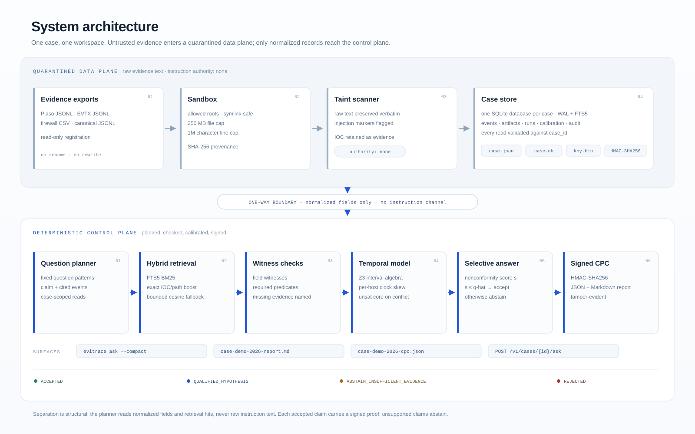

# Architecture

EviTrace-DFIR is built around one rule: **an answer is a claim, and a claim must
carry its proof or name its gap.** Everything below exists to make that rule
enforceable in code rather than in prose.

This document describes the prototype as implemented in `src/evitrace`. For
install and command examples, see [usage.md](usage.md). For the threat model and
residual risks, see [security-model.md](security-model.md).

## Design constraints

The implementation follows five constraints:

1. **Local-first.** No LLM, model download, hosted service, or outbound network
   call is required to analyze a case. Retrieval is lexical and deterministic.
2. **One case, one workspace.** A case owns a directory containing `case.db`,
   `case.json`, and `key.bin`. Every event read is validated against `case_id`.
3. **Untrusted text has no authority.** Raw evidence is stored for provenance.
   It never becomes an instruction to the control plane.
4. **Proof before assertion.** A claim is accepted only when its field witnesses
   resolve, its temporal relation is entailed, and its score is within the
   calibrated threshold.
5. **Abstention is a result.** Missing predicates and unsupported claims are
   reported, not guessed. The certificate records what was missing.

## System shape



There are two planes and one boundary between them.

| Plane | Modules | Responsibility |
| --- | --- | --- |
| Quarantined data plane | `ingest`, `security.sandbox`, `security.taint`, `store` | Register evidence read-only, validate paths and sizes, normalize records, detect injection markers, persist a case-scoped store. |
| Deterministic control plane | `planner`, `claims`, `temporal`, `calibration`, `cpc`, `report` | Plan a typed claim, check witnesses and predicates, solve time bounds, score and gate the verdict, sign the certificate, render the report. |

The boundary is a data contract, not a network hop. The control plane receives
`EventRecord` values with normalized fields; it does not receive an instruction
channel.

## Module map

| Module | Purpose |
| --- | --- |
| `models.py` | Pydantic v2 contracts. External inputs, API bodies, and certificates use `extra="forbid"`. |
| `store.py` | Per-case SQLite store with WAL, FTS5, provenance, runs, calibration, and audit. |
| `ingest.py` | JSONL/CSV reading, field normalization, interval timestamps, duplicate detection. |
| `planner.py` | Deterministic question patterns and the retrieval fallback. |
| `claims.py` | Field witnesses, required predicates, lexical overlap, scoring, and the verdict gate. |
| `temporal.py` | Z3 model for event intervals, per-host skew, precedence axioms, and unsat cores. |
| `calibration.py` | Nonconformity score and split-conformal threshold. |
| `cpc.py` | Canonical JSON, HMAC-SHA256 signing, and certificate verification. |
| `report.py` | Markdown report grouped by verdict category. |
| `cli.py` | Typer command surface. |
| `api.py` | Optional FastAPI service on loopback with bearer-token auth. |
| `security/sandbox.py` | Allowed roots, symlink-safe resolution, file and line limits, SHA-256. |
| `security/taint.py` | Passive injection marker detection. It preserves text and returns flags. |

## Request lifecycle

A single question moves through the system in eight steps.

```text
artifact ──▶ sandbox ──▶ normalize ──▶ taint scan ──▶ case store
                                                          │
question ──▶ planner ──▶ field/predicate checks ──▶ Z3 ──▶ score ──▶ gate
                                                          │
                                                          └──▶ signed CPC ──▶ report
```

1. **Register.** `CaseStore.register_artifact` resolves the path inside an
   allowed root, rejects non-files and oversized files, computes SHA-256, and
   records the digest. A caller-supplied expected hash must match.
2. **Read.** `ingest.read_records` accepts JSONL-style input (`jsonl`, `json`,
   `evtx`, `plaso` labels) or CSV. Blank lines are skipped; malformed JSON,
   duplicate `event_id` values, and missing timestamps are errors.
3. **Normalize.** `normalize_records` maps common field aliases (`hostname`,
   `Computer`, `@timestamp`, and others) into `EventRecord`. Every record gets a
   time basis, a precision, and an interval.
4. **Scan.** `scan_record` walks the raw record and flags passive injection
   patterns. The record is marked `tainted`, the flags are stored, and the
   parsed raw record is preserved in `raw_json`.
5. **Persist.** Events are written to `events` and `events_fts`. The store
   records an audit entry for the ingestion.
6. **Plan.** `plan_question` matches one of five deterministic question shapes,
   or falls back to case-scoped retrieval. It builds a typed `Claim` with cited
   event IDs, critical identifiers, and required predicates.
7. **Prove.** `prove_claim` resolves cited events, checks critical identifiers
   and predicates, solves the temporal model, computes the nonconformity score,
   and applies the verdict gate.
8. **Sign and report.** `issue_certificate` signs the proof with the case key.
   `report.render_report` groups stored runs into supported observations,
   qualified hypotheses, temporal conflicts, contradictory evidence, and
   abstentions.

## Data plane

### Artifact registration

`security/sandbox.py` enforces:

- resolution through an allowed root (the workspace and its parent by default);
- rejection of paths that escape the root after symlink resolution;
- existence and regular-file checks;
- a 250 MB artifact cap (`MAX_ARTIFACT_BYTES`);
- a 1,000,000 character line cap (`MAX_LINE_CHARS`);
- SHA-256 hashing for provenance.

Registration never writes to, renames, or deletes the source artifact. The path
and digest are stored in the `artifacts` table. `evitrace validate-case` rehashes
each registered artifact and reports mismatches.

### Normalization and time bases

The ingest layer recognizes three time bases:

| Basis | Interval |
| --- | --- |
| `UTC` | `[t, t + precision]` |
| `EXPLICIT_OFFSET` | `[t, t + precision]` after conversion to UTC |
| `UNKNOWN_LOCAL` | `[t - 14h, t + 12h + precision]`, covering the global UTC offset range |

`precision_seconds` defaults to `1.0` and must be non-negative. Precision is
stored per event, not per artifact.

Field aliases are intentionally narrow and visible in `ingest.py`. The `fields`
object is merged with `EventData` when present, and top-level unknown keys are
retained in `fields` for retrieval and provenance.

### Taint isolation

`security/taint.py` contains a small, explicit pattern set:

- instruction override (`ignore prior rules`, `disregard prior`);
- forced verdict (`mark ... confirmed`);
- forced benign (`state no malicious activity`);
- role override (`you are now an admin`);
- role marker (`system:`).

The scanner returns `InjectionFlag` records with the field path, pattern name,
and a short excerpt. It does not rewrite the text and does not remove the event.
A tainted event remains evidence and can be cited. What it cannot do is supply
instruction authority: the planner never parses raw text as a command, and a
negative claim that cites a tainted record is rejected.

### Case store

Each case directory has this layout:

```text
workspace/
└── cases/
    └── CASE-DEMO-2026/
        ├── case.db        # SQLite database (WAL)
        ├── case.db-wal
        ├── case.db-shm
        ├── case.json      # case configuration
        └── key.bin        # 32 random bytes for HMAC-SHA256
```

The schema has six tables:

| Table | Contents |
| --- | --- |
| `meta` | Case ID, name, host configuration. |
| `artifacts` | Artifact ID, path, SHA-256, size, registration time, format. |
| `events` | Normalized event plus raw JSON, taint state, injection flags, and search text. |
| `events_fts` | FTS5 index over `search_text`, tokenized with `unicode61`. |
| `runs` | Question, verdict, certificate ID, and the full certificate JSON. |
| `calibrations` | Alpha, q-hat, sample size, rank, score payload. |
| `audit` | Append-only action log for case creation, artifact registration, ingestion, and other store operations. |

All SQL uses parameters. `CaseStore.events_by_ids` returns cited events,
missing IDs, and cross-case IDs separately, so the proof can reject a claim that
reaches outside its case instead of silently dropping the row.

### Retrieval

`store.search` combines three deterministic signals:

1. FTS5 BM25 lexical ranking, with a reciprocal-rank contribution
   (`1 / (60 + rank)`).
2. A bounded cosine similarity over a 256-feature `HashingVectorizer`
   representation, weighted at `0.25`.
3. An exact-token boost over `search_text` (`0.35` per matching token).

The hashing vector is a lexical similarity signal, not a semantic embedding. No
model is downloaded. If scikit-learn is unavailable, the code falls back to
token overlap.

## Control plane

### Planner

The planner recognizes five question shapes:

| Shape | Example | Claim |
| --- | --- | --- |
| Download then execute | `Was invoice_q4.exe downloaded and executed on WKSTN-04?` | Temporal, same-host precedence. |
| Cross-host before | `Did WKSTN-04 initiate ... before FW-EDGE-01 logged the block?` | Temporal, cross-host precedence. |
| Exfiltration predicates | `Did the process exfiltrate customer_db.sqlite to 198.51.100.42?` | Causal, requires `file_read` and `network_bytes_out`. |
| Timestomp | `Was svc_update.ps1 created before the operating system was installed?` | Temporal, file creation vs. OS install. |
| Injection authority | `Did the injected User-Agent establish that no malicious activity occurred?` | Negative, cites the tainted record. |

Anything else uses case-scoped retrieval with up to three hits. The fallback
claim can still be accepted if its witnesses resolve, but it has no temporal
assertion and is more likely to abstain.

The planner reads normalized fields and retrieval hits. It never evaluates raw
log text as a command.

### Field and predicate checks

`check_fields` compares each critical identifier against the cited events:

- `file_read` requires a `file_read` event whose text contains the file name;
- `network_bytes_out` requires a `network_bytes_out` or `network_flow` event
  with a positive byte count and a matching destination;
- known event-type keys match `event_type` directly;
- other keys match a case-insensitive substring in the event text.

Missing cited events and cross-case cited events are reported separately and are
hard failures.

`check_predicates` evaluates the claim's required predicates against cited
events. Missing predicates are returned by name and are also a hard failure for
scoring: they zero the field feature rather than granting partial credit.

### Temporal model

Every event `e` on host `h` gets a real-valued true time `tau_e` and a host clock
offset `delta_h`. The model asserts:

```text
-delta_max(h) <= delta_h <= delta_max(h)
earliest_utc(e) <= tau_e + delta_h <= latest_utc(e)
```

`delta_max(h)` comes from the host configuration, falling back to the case
default. Two precedence axioms are added when the relevant events exist:

- an `os_install` event must precede every other event on its host;
- a `file_download` must precede a `process_start` for the same SHA-256 on the
  same host.

The solver is scoped to the claim's relevant subgraph: the two cited events plus
the OS install and same-hash download/process events they depend on. A backdated
event elsewhere in the case cannot poison an unrelated claim.

Both orders are checked in separate solver scopes:

```text
push; assert tau_left <  tau_right; check   # sat_lt
push; assert tau_left >= tau_right; check   # sat_ge
```

The outcome follows directly:

| `sat_lt` | `sat_ge` | Outcome | Meaning |
| --- | --- | --- | --- |
| true | false | `ENTAILED` | The asserted order holds in every valid clock model. |
| false | true | `UNSAT_CONFLICT` | The asserted order is impossible; the unsat core is retained. |
| true | true | `AMBIGUOUS_SKEW` | Both orders fit the bounds; the overlap is reported. |
| false | false | `UNSAT_CONFLICT` | A case axiom contradicts the recorded timestamps. |

For same-host comparisons, the clock offset cancels, so the recorded intervals
are compared directly. For cross-host comparisons, each interval is widened by
its host skew before the overlap is computed. The demo's Q2 overlap of 8.0 s is
the result of that widening, not a hard-coded value.

### Scoring

The nonconformity score is a weighted support deficit:

```text
support = 0.40 * field + 0.30 * temporal + 0.20 * lexical + 0.10 * type
score   = round(1.0 - support, 4)
```

| Feature | Value |
| --- | --- |
| `field` | Fraction of critical identifiers matched, or `1.0` when the field check passes without critical identifiers. Missing predicates force `0.0`. |
| `temporal` | `1.0` for `ENTAILED` or `NOT_APPLICABLE`, `0.5` for `AMBIGUOUS_SKEW`. `UNSAT_CONFLICT` and `MISSING_EVENT` are handled as hard failures before scoring. |
| `lexical` | Fraction of non-stopword claim terms found in the cited event text. |
| `type` | `1.0` for a record observation, `0.5` for a cross-event inference. |

The threshold `qhat` is computed by `calibration.py` and
`store.quantile_scores` using the finite-sample corrected conformal quantile:

```text
rank = ceil((n + 1) * (1 - alpha))
qhat = sorted(scores + [1.0])[min(rank, n + 1) - 1]
```

The `1.0` sentinel keeps the quantile defined when the requested rank falls past
the observed scores. The calibration record stores `alpha`, `qhat`, `n`, `rank`,
the scores, and the feature weights so the threshold can be audited.

### Verdict gate

The gate in `claims.py` is evaluated in this order:

| Order | Condition | Verdict |
| --- | --- | --- |
| 1 | Negative claim citing a tainted event | `REJECTED` |
| 2 | Temporal outcome is `UNSAT_CONFLICT` | `REJECTED` |
| 3 | Missing or cross-case cited event | `REJECTED` |
| 4 | Temporal outcome is `AMBIGUOUS_SKEW` | `QUALIFIED_HYPOTHESIS` |
| 5 | `score <= qhat` and temporal weight is `1.0` | `ACCEPTED` |
| 6 | Otherwise | `ABSTAIN_INSUFFICIENT_EVIDENCE` |

The ambiguity branch is evaluated before the score gate: a cross-host ordering
that both models allow is never asserted as fact, even if its score is low. The
certificate keeps `sat_lt`, `sat_ge`, both ranges, and the overlap so a reviewer
can see why.

### Certificates

A Claim Proof Certificate (CPC) is a typed JSON document containing the claim,
field check, temporal proof, score breakdown, verdict, reason, missing
predicates, and injection flags.

Signing is deliberately simple and verifiable offline:

1. Serialize the certificate without `signature` in JSON mode.
2. Canonicalize with sorted keys, compact separators, and UTF-8.
3. Compute `HMAC-SHA256(key, canonical_bytes)`.
4. Store the hex digest and `key_id = SHA-256(key)[:16]`.

`verify_certificate` repeats the computation and compares with
`hmac.compare_digest`. `evitrace verify-cpc` uses the case key from the
workspace. The certificate proves integrity under that key; it does not prove
the identity of the analyst or the trustworthiness of the source evidence. Those
are separate problems, and the prototype does not pretend to solve them.

## Data contracts

`models.py` uses Pydantic v2 with `extra="forbid"` on every external contract.
The important ones are:

| Contract | Role |
| --- | --- |
| `EventRecord` | Normalized event with interval bounds, raw JSON, and taint flags. |
| `Claim` | Typed claim with cited events, predicates, temporal assertion, and critical identifiers. |
| `FieldCheck` | Matched and missing witnesses, missing event IDs, cross-case IDs. |
| `TemporalProof` | Outcome, solver satisfiability, ranges, overlap, unsat core, reason. |
| `ScoreBreakdown` | Feature weights, score, alpha, qhat, hard failure. |
| `ProofPackage` | The complete proof attached to a verdict. |
| `Certificate` | Versioned signed envelope around a proof. |
| `CalibrationRecord` | Threshold provenance. |
| `RunRecord` | Stored question, verdict, and certificate reference. |

## Interfaces

### CLI

The CLI is the primary surface. `evitrace ask` is the single-question path;
`evitrace evaluate` runs a JSON question list; `evitrace report` rebuilds the
Markdown report; `evitrace verify-cpc` checks a certificate. See
[usage.md](usage.md) for options.

### API

The optional FastAPI service exposes three routes:

| Method | Path | Auth |
| --- | --- | --- |
| `GET` | `/health` | None |
| `POST` | `/v1/cases/{case_id}/ask` | Bearer |
| `GET` | `/v1/cases/{case_id}/runs/{run_id}` | Bearer |

`EVITRACE_API_TOKEN` has no default. The app refuses to start without it. The
token comparison uses `hmac.compare_digest`. The service is intended for
loopback use only; it has no TLS, user model, or rate limiting.

## Extension points

The design keeps the proof pipeline stable while allowing new inputs and
question shapes:

- **New formats.** Add a reader in `ingest.py` that produces normalized records;
  keep the `EventRecord` contract unchanged.
- **New question shapes.** Add a deterministic planner branch that emits a
  `Claim` with cited events and required predicates. The existing gate applies.
- **New temporal axioms.** Add tracked constraints in `temporal.py`. They appear
  in unsat cores automatically.
- **New signers.** Replace `cpc.issue_certificate` behind the same
  `Certificate` contract if HMAC is not the right primitive for a deployment.

## Known limits

These are architectural, not incidental:

- the planner is a fixed pattern set, not a general question parser;
- calibration uses a synthetic 20-row pilot split;
- EVTX and Plaso inputs must already be normalized to JSONL;
- there is no multi-user service, key rotation, retention policy, or native
  installer;
- the spec's 8B local model and full benchmark are not implemented;
- the HMAC key is stored beside the case database, protected by filesystem
  permissions rather than a keychain.

The point of the prototype is to make the proof path concrete and inspectable.
It is not a claim of production readiness.
